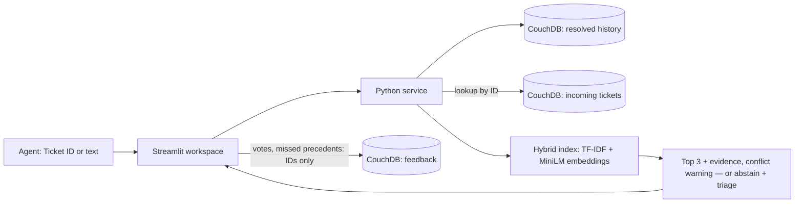

# Solution Design — Solari Support Similarity Assistant

## 1. The problem, in my words

Solari's support team (~150 tickets/day, growing) keeps re-solving problems it has already solved. Agents either spend too long on a ticket or, worse, **give a different answer than another customer got last month**. Jamie wants an agent to see, for each new ticket, the most similar past tickets and how they were resolved.

So the job is **retrieval of trustworthy precedent**, not diagnosis: show the agent the few resolved tickets most like this one, with the evidence for each, and let the agent decide. Two failure modes matter more than raw accuracy: a confident-looking wrong precedent (costly for billing/security answers), and two precedents that disagree without the agent noticing. The system should therefore **abstain** when nothing is similar enough, and **warn** when similar precedents were resolved differently.

## 2. Assumptions (and why)

| Assumption | Why |
|---|---|
| "Similar" = same customer-visible symptom, judged from subject + description; category, tags and error codes are supporting signals | They exist at ticket arrival; categories and tags are often missing or wrong on new tickets |
| Show **at most 3** results, only above a minimum score; otherwise say "no strong match" | Agents read the top few; a weak result invites a wrong answer |
| Only **resolved, approved** resolutions are reusable; production also requires a review in the last 180 days | Resolution notes go stale (product changes) and may be customer-specific |
| History is tens of thousands of tickets, not millions; "a lot more volume" ≈ 10× (1,500/day) | Mid-size SaaS; 10× affects corpus growth and refresh more than query load (a few searches per ticket) |
| Search should feel instant: p95 under 1 s | Agents search while the customer waits |
| One support workspace; all agents may see all tickets; data is synthetic | Matches the brief; multi-tenant access rules are a discovery question |
| Incoming tickets are created by the helpdesk, not by this tool | The assistant should not become a second ticketing system |
| Ticket text must not leave Solari's environment | Support tickets contain customer data; a local model avoids a data-processing agreement |

Questions I would take back to Jamie: what makes a precedent "useful"; cost of a wrong suggestion vs a miss; real corpus size; who may see which customers' tickets; how resolutions are reviewed and retired.

## 3. Approach and architecture

**Retrieval (hybrid).** Score = 0.55 × TF-IDF cosine (word 1–2-grams, subject weighted double) + 0.45 × semantic similarity from a local `all-MiniLM-L6-v2` sentence-transformer, plus a small tag-overlap bonus and a boost for an exact error-code match. Keywords catch exact product terms and codes; embeddings catch paraphrases ("billed two times" ↔ "charged twice" with only 9% word overlap). MiniLM rates any two support tickets ~0.3 similar, so semantic similarity is rescaled above that baseline — one 0.30 threshold then works with or without the model, which falls back to keyword-only matching if unavailable.

**Guardrails.** Error codes are compared per family (HTTP, SQLSTATE, ORA…): a precedent recording a *different* code in the same family (ORA-01017 vs ORA-00942) is excluded. Each result shows its evidence separately (shared terms, semantic score, tags, codes) and the original resolution verbatim. When two shown precedents describe similar problems but were resolved differently, the agent is told to confirm which cause applies — this directly targets "different answers to similar problems".

**Data and freshness.** CouchDB is the source of truth: a resolved-only history database (enforced by a CouchDB validation function), an incoming-ticket database for lookup, and a feedback database. The service keeps one in-memory index per process, reads CouchDB changes incrementally, rebuilds in the background while searches continue, and caches embeddings on disk so a restart only encodes changed tickets (5,000 tickets: 56 s → 0.7 s).

**Learning from agents.** 👍/👎 votes and "the right precedent was T-…" reports are stored as IDs and numbers only. For a miss, the app records *why* it was hidden (below threshold, outside review window, category filter, code conflict…). A report shows helpful rate by score band and precedents agents keep rejecting; a replay re-scores real tickets under different thresholds/weights before anyone changes them.

## 4. Main trade-offs

| Decision | Chosen because | Accepted cost |
|---|---|---|
| Hybrid keyword + local embeddings, not keyword-only | Paraphrases are common in support tickets; embeddings are the "AI" that genuinely helps here | ~1 GB of Python dependencies, 90 MB model |
| Local model, not a hosted embedding/LLM API | No ticket text leaves Solari; no per-call cost or vendor approval | Smaller model than hosted options |
| Show original resolutions, no LLM summaries | Zero hallucination risk; agents see exactly what was done | Long notes take longer to read |
| Abstain below a threshold | A wrong precedent is worse than none | Some weakly-worded true matches are hidden (the closest score is still shown) |
| In-process index, not a search engine | Fast and simple at tens of thousands of tickets; no extra infrastructure | One index per app process; not horizontally scalable as-is |
| CouchDB | Document store with a changes feed for incremental refresh and server-side write rules | It stores data; ranking happens in Python |
| Feedback stores IDs only | Labels without copying customer text | Searches without a stored incoming ticket can't be replayed |

**Evidence.** On 32 synthetic scenarios (12 development for tuning, 20 held-out for checking) hybrid retrieval achieves Recall@3 = 1.0, correct abstention = 1.0 and zero irrelevant results under the production review policy; search p95 ≈ 25 ms. The same person wrote the data and the labels, so this is regression evidence, not proof of real-world quality — which is why the feedback loop exists. 252 automated tests cover ranking, guardrails, UI flows, and the CouchDB write rules against a real CouchDB.

**Scope.** The core v1 is search, evidence and abstention. The consistency warning, feedback loop and background indexing go beyond a minimal v1; I added them because they map directly to Jamie's two stated pains and to the "10× volume" question.

## 5. What I'd do differently with…

**More time**
- Replay real agent feedback to re-tune the threshold and weights (the tooling exists; it needs real votes).
- Knowledge-gap report: cluster recent no-match tickets by topic so the team knows which help articles to write, and alert when many new tickets match one precedent (an early incident signal).
- Production hardening: validate login against Solari's identity provider, a global rate limit, proper PII detection, backup/restore and load tests.

**More data**
- Independent relevance labels from agents (50+ real tickets beats my 32 synthetic cases), then a held-out set nobody tuned on.
- Calibrate scores into "how often was a result at this score helpful", so the UI can show real confidence.
- Learn which fields matter (product area, customer plan, version) and use resolution outcomes (reopened? escalated?) as quality signals.

**More budget**
- Helpdesk integration (Zendesk/Freshdesk sidebar + webhook) so matches appear inside the agent's existing tool — the biggest adoption lever.
- A one-line LLM summary of each precedent's fix, always shown next to the original and citing it, once Solari approves sending ticket text to a model provider.
- At hundreds of thousands of tickets or several app servers: a shared search service (OpenSearch or pgvector) with incremental indexing, and a larger or fine-tuned embedding model.
